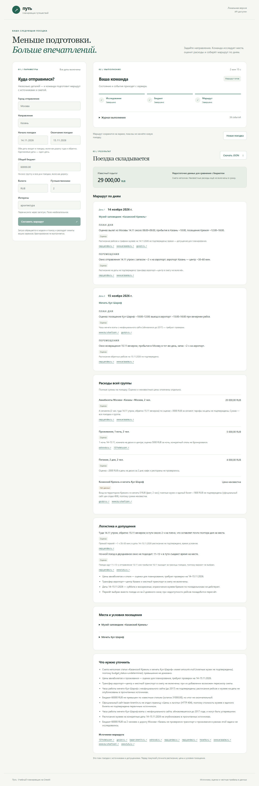
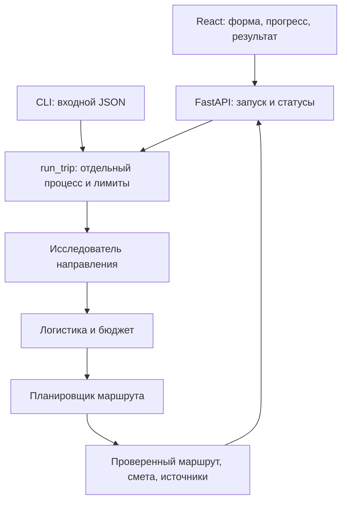

# CrewAI · Планировщик путешествий

**Задайте поездку — получите маршрут по дням, смету и источники от команды из трёх AI-агентов.**

Учебное локальное приложение: **React → FastAPI → CrewAI**. Реализованы все семь этапов,
от подключения модели и инструментов до веб-интерфейса с прогрессом выполнения.
Проект создан по мотивам курса Simplilearn «Agent Team Orchestration with CrewAI»;
архитектура и реализация — собственный учебный вариант.

[Установка](#установка) · [Запуск](#запуск) · [Архитектура](#архитектура) · [Проверки](#проверки) · [Подробная документация](docs/DEVELOPMENT.md) · [План и журнал](SPEC.md)



*Снимок реального запуска при проверке интерфейса; пример не является актуальным предложением поездки.*

## Что умеет приложение

- Принимает город отправления, направление, даты, общий бюджет, валюту, количество путешественников и интересы.
- Исследует направление через Tavily basic и читает найденные страницы.
- Подбирает музеи, архитектуру, заведения и места для покупок с учётом интересов.
- Составляет программу по дням с перемещениями и расходами всей группы.
- Показывает текущую задачу, события выполнения, маршрут, смету и ссылки на источники.
- Восстанавливает наблюдение за поездкой после обновления страницы и позволяет скачать JSON.
- Проверяет структуру ответов, даты, источники, выбранные места и согласованность денежных итогов.

Неизвестные расходы остаются неизвестными: неполная смета не означает соблюдение бюджета.
Цены и расписания могут быть оценочными; бронирования и оплаты нет.

## Установка

Нужны **Python 3.12**, **Node.js >=26**, Git и ключи Polza AI и Tavily.
Python-пакет допускает версии >=3.10,<3.14; проверенное окружение — 3.12.14.
Команды ниже предназначены для PowerShell, выполняются из корня проекта.

```powershell
git clone https://github.com/KatnikovAA/CrewAI.git
cd CrewAI
py -3.12 -m venv .venv
.\.venv\Scripts\python.exe -m pip install -e '.[test]' --no-compile
npm.cmd --prefix frontend ci
# Существующие настройки сохраняются.
if (-not (Test-Path .env)) { Copy-Item .env.example .env }
if (-not (Test-Path frontend/.env.local)) {
    Copy-Item frontend/.env.example frontend/.env.local
}
notepad .env
```

Заполните корневой `.env`:

```dotenv
LLM_PROVIDER=openai
LLM_MODEL=deepseek/deepseek-v4.1-flash
LLM_API_KEY=
LLM_BASE_URL=https://polza.ai/api/v1
TAVILY_API_KEY=
API_CORS_ORIGIN=http://localhost:5173
```

Вставьте свои ключи после `=` только локально. Ключ Polza: [личный кабинет](https://polza.ai/dashboard/api-keys);
ключ поиска: [Tavily](https://app.tavily.com/). Интерфейс CrewAI использует `openai`,
а сервисом остаётся Polza AI. Полный ID модели сохраняется с префиксом `deepseek/`.

`frontend/.env.local` содержит только публичный адрес сервера:

```dotenv
VITE_API_BASE_URL=http://127.0.0.1:8000
```

API-ключи хранятся на сервере. `.env`, `.env.local`, окружения, сборки и локальные журналы исключены из Git.
Реальные поездки расходуют средства или квоты подключённых сервисов.

## Запуск

### Двойным щелчком в Windows

После установки откройте в папке проекта **[Запустить планировщик.cmd](Запустить%20планировщик.cmd)**.
Он запускает API и интерфейс, проверяет готовность и открывает браузер.
Повторное нажатие открывает уже работающее приложение.

Для завершения используйте **[Остановить планировщик.cmd](Остановить%20планировщик.cmd)**.
Закрытие вкладки не останавливает сервер. Остановка прерывает текущую поездку;
скачанный результат остаётся. Локальные журналы запуска находятся в `.launcher/`.

### Вручную для разработки

Первый терминал, из корня проекта:

```powershell
$env:API_CORS_ORIGIN = 'http://localhost:5173'
.\.venv\Scripts\python.exe -B -m uvicorn travel_planner.api:app --host 127.0.0.1 --port 8000 --workers 1
```

Второй терминал, также из корня:

```powershell
npm.cmd --prefix frontend run dev
```

Откройте **[localhost:5173](http://localhost:5173)**.
Документация API: [127.0.0.1:8000/docs](http://127.0.0.1:8000/docs).
Используйте `localhost` для интерфейса: этот адрес совпадает с разрешённым CORS origin.
Запускайте один worker без reload во время поездки.

### Через командную строку

```powershell
.\.venv\Scripts\python.exe -B scripts/run_trip.py examples/trip.json
# Другой пример входных параметров:
.\.venv\Scripts\python.exe -B scripts/run_trip.py examples/minsk-case.json
```

Оба примера запускают настоящую Crew. Проверьте даты и параметры перед запуском.
CLI сохраняет уникальный JSON и соседний журнал `*.events.jsonl` в `results/`;
существующие файлы не перезаписываются.

## Архитектура



| Агент | Ответственность | Инструменты |
|---|---|---|
| Исследователь | Места, условия посещения, источники | Поиск, чтение страниц |
| Специалист по бюджету | Транспорт, жильё, питание, активности | Поиск, чтение, калькулятор |
| Планировщик | Программа по дням и согласованные итоги | Калькулятор |

Одна Crew с `Process.sequential`; результаты предыдущих задач передаются как контекст.
Pydantic, программные guardrail и проверки качества контролируют выходные данные.
Калькулятор использует Decimal: суммы уже относятся ко всей группе и всей поездке,
повторного умножения и автоматической конвертации валют нет.

Основные версии: CrewAI/crewai-tools **1.15.28**, FastAPI **0.143.1**,
React **19.3.1**, Vite **8.3.4**, TypeScript **7.0.2**.
Python-зависимости закреплены в `pyproject.toml`, клиентские — в `frontend/package-lock.json`.

### HTTP API

| Метод | Путь | Назначение |
|---|---|---|
| GET | `/health` | Проверить доступность сервера |
| POST | `/trips` | Создать поездку; запускает реальные обращения к сервисам |
| GET | `/trips/{trip_id}` | Получить состояние и события |
| GET | `/trips/{trip_id}/result` | Получить завершённый результат |

Состояния: `queued → running → completed` или `failed`.
Подробные контракты и примеры запросов доступны в OpenAPI и [руководстве](docs/DEVELOPMENT.md).

## Проверки

Следующие команды проверяют код без запуска платной поездки:

```powershell
$env:CREWAI_STORAGE_DIR = Join-Path (Get-Location) '.crewai'
.\.venv\Scripts\python.exe -B -m unittest discover -s tests -v
.\.venv\Scripts\python.exe -B -m pip check
npm.cmd --prefix frontend test
npm.cmd --prefix frontend run build
```

Сборка интерфейса включает проверку TypeScript. Отдельная команда:
`npm.cmd --prefix frontend run typecheck`.

Реальные интеграционные проверки ранее сохранены в `results/` и описаны в [SPEC.md](SPEC.md).
Для кейса Москва → Минск, 19–25 октября 2026, подтверждены три последовательных
успешных запуска: 19, 20 и 24 места, HTTP 200 и согласованные результаты.
Это подтверждение конкретного сценария; будущие ответы модели и доступность сети могут отличаться.

## Структура проекта

```text
frontend/                  React, TypeScript, CSS, тесты интерфейса
src/travel_planner/
  agents/                  Роли и фабрики агентов
  tools/                   Поиск, чтение и калькулятор
  api.py, api_jobs.py       HTTP-контракты и управление поездками
  crew.py, runner.py        Команда, события, лимиты, остановка процесса
  models.py, tasks.py       Схемы данных, задачи и guardrail
  planning.py              Проверки качества и распределения программы
  structured_task.py       Контролируемая обработка структурированного ответа
  llm.py, settings.py       Модель и настройки
scripts/                   CLI, проверки и Windows launcher
examples/                  Входные параметры Казани и Минска
results/                   Исторические отчёты и снимки проверок
docs/DEVELOPMENT.md         Подробные пояснения по этапам
SPEC.md                    Архитектурные решения и журнал проекта
```

## Состояние и ограничения

Все этапы 0–7 реализованы и проверены: архитектура, LLM, tools, agents, tasks,
последовательная Crew, FastAPI и React. Дальнейшие улучшения фиксируются в общем `SPEC.md`.

- Приложение локальное, для одного пользователя, без авторизации и базы данных; одна поездка одновременно.
- История HTTP хранится в памяти и теряется после перезапуска API; JSON-отчёты на диске сохраняются.
- Общий лимит поездки — 420 секунд и 24 обращения к модели. Полная Crew: до 12 000 выходных токенов и 90 секунд на LLM-запрос.
- Исследователь ограничен 240 секундами, остальные агенты — 180; общий дедлайн остаётся 420 секунд.
- До 24 исследованных мест; полные дни проверяются на содержательность, питание и отсутствие повторов.
- Чтение страниц не исполняет JavaScript; CAPTCHA, авторизация и недоступные сайты ограничивают поиск.
- Валидаторы проверяют согласованность данных; актуальность цен, расписаний и смысловую реализуемость нужно уточнять перед поездкой.
- В `results/` сохранены как успешные, так и неудачные попытки. Они документируют проверку, а не представляют каждый файл как готовый маршрут.
