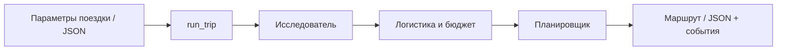

# CrewAI · Планировщик путешествий

**Три AI-агента превращают параметры поездки в маршрут по дням, смету и список источников.**

Учебный Python-проект по мотивам курса Simplilearn «Agent Team Orchestration with CrewAI».
Он показывает полный путь: **tools → agents → tasks → process → crew**.
Архитектура — собственный учебный вариант; исходники курса не копировались.

[Быстрый старт](#быстрый-старт) · [Архитектура](#архитектура) · [Проверки](#проверки) · [План развития](#план-развития) · [Спецификация](SPEC.md)

> **Состояние: этапы 1–5 завершены.** Доступен запуск из командной строки с JSON-результатом
> и журналом событий. FastAPI и React запланированы. После завершения последнего этапа
> этот README будет дополнен инструкциями по веб-приложению.

## Возможности

- Исследование направления через Tavily basic и чтение найденных страниц.
- Расчёт полных расходов всей группы с точностью Decimal.
- Последовательная работа агентов с передачей результатов в контекст.
- Проверка структуры, дат, источников, валюты и согласованности итогов.
- События прогресса, промежуточные результаты, ограничения времени и числа запросов.
- Явное разделение подтверждённых сведений, оценок и неизвестных расходов.

На входе: город отправления, направление, даты, бюджет, число путешественников и интересы.
На выходе: маршрут, известный подытог расходов и оговорки. Бронирование и оплата не реализованы.

## Архитектура



| Агент | Задача | Инструменты |
|---|---|---|
| Исследователь | Места, условия посещения, источники | Поиск, чтение страниц |
| Специалист по бюджету | Транспорт, жильё, питание, активности | Поиск, чтение, калькулятор |
| Планировщик | Маршрут по дням и согласованные итоги | Калькулятор |

Одна Crew, `Process.sequential`. Контракты результатов проверяются Pydantic и программными guardrail.
Выбранная конфигурация: **Polza AI / DeepSeek V4.1 Flash**, CrewAI **1.15.28**.
Поддерживаемый Python: **>=3.10,<3.14**; проверки выполнялись на **3.12.14**.

## Быстрый старт

Команды для PowerShell; нужен установленный Python 3.12 и ключи Polza AI и Tavily.

```powershell
git clone https://github.com/KatnikovAA/CrewAI.git
cd CrewAI
py -3.12 -m venv .venv
.\.venv\Scripts\python.exe -m pip install -e . --no-compile
# Сохраняем существующие настройки, если .env уже есть.
if (-not (Test-Path .env)) { Copy-Item .env.example .env }
notepad .env
```

Заполните переменные по инструкции ниже. Затем запустите пример:

```powershell
# Реальные обращения к LLM и Tavily расходуют лимиты / средства аккаунтов.
.\.venv\Scripts\python.exe -B scripts\run_trip.py examples\trip.json
```

Пример: Москва → Казань, 14–15 ноября 2026, двое путешественников, бюджет 60 000 RUB.
Обновите даты перед использованием, если они уже прошли. Результаты сохраняются в `results/`:
уникальный JSON и соседний `*.events.jsonl`. Существующие файлы не перезаписываются.

## Проверки

Из корня проекта, без настоящих запросов к модели:

```powershell
$env:CREWAI_STORAGE_DIR = Join-Path (Get-Location) '.crewai'
.\.venv\Scripts\python.exe -B -m unittest discover -s tests -v
.\.venv\Scripts\python.exe -B -m pip check
```

Реальный полный запуск этапа 5 ранее подтверждён отдельно: около 102 секунд,
12 HTTP-обращений к LLM, известный подытог **23 180 RUB**. Смета неполная:
`complete=false`, `budget_status=undetermined`. Это пример работы, а не актуальное предложение поездки.
Подробности и ограничения — в конце README и в [журнале проекта](SPEC.md).

## Структура проекта

```text
src/travel_planner/
  agents/          # Роли и фабрики трёх агентов
  tools/           # Поиск, чтение страниц, Decimal-калькулятор
  models.py        # Вход поездки и контракты результатов
  tasks.py         # Задачи, контекст и guardrail
  crew.py          # Сборка последовательной команды
  runner.py        # Запуск, события, лимиты и остановка процесса
  llm.py           # Фабрика подключения к модели
  settings.py      # Настройки окружения
  runtime.py       # Служебное хранилище и телеметрия
scripts/           # CLI поездки и отдельные проверки компонентов
examples/trip.json # Пример входных параметров
results/           # Сохранённые учебные запуски и диагностика
tests/             # Автоматические проверки без реальных API
SPEC.md            # Общий план, критерии и история проверок
```

`.env`, `.venv`, байткод и служебное хранилище `.crewai` исключены из Git.
`.env.example` содержит только пустые значения ключей. Исторические отчёты в `results/`
включают неудачные попытки; подтверждённый итог этапа 5 — `stage5-attempt9.json`.

## План развития

| Этап | Состояние |
|---|---|
| 0. Цель и архитектура | Готово |
| 1. Python и подключение LLM | Готово |
| 2. Инструменты | Готово |
| 3. Агенты | Готово |
| 4. Задачи и контракты | Готово |
| 5. Crew и последовательный процесс | Готово |
| 6. FastAPI и статусы выполнения | Запланирован |
| 7. React: форма, прогресс, результат | Запланирован |

Ниже — настройки и технические пояснения по реализованным этапам.
## Подробная настройка (PowerShell)

```powershell
# Из корня клонированного проекта (окружение создаётся один раз):
py -3.12 -m venv .venv
.\.venv\Scripts\python.exe -m pip install -e . --no-compile
# Выполняйте копирование только если .env ещё не существует:
if (-not (Test-Path .env)) { Copy-Item .env.example .env }
notepad .env
```

В `.env` локально заполните провайдера, модель и ключ после их выбора.
Не отправляйте ключ в чат. `.env` и `.venv` исключены из Git.
Активация окружения не требуется: команды используют его Python напрямую.
Для создания окружения используется установленный Python 3.12 через `py`.

Проверка установки:

```powershell
.\.venv\Scripts\python.exe -m pip check
$env:CREWAI_STORAGE_DIR = Join-Path (Get-Location) '.crewai'
.\.venv\Scripts\python.exe -c "from crewai import LLM; import travel_planner; print('Импорты OK')"
```

Проверка подключения (один короткий платный запрос согласно тарифу провайдера):

```powershell
.\.venv\Scripts\python.exe scripts\check_llm.py
```

Выбран сервис **Polza AI**, который предоставляет OpenAI-совместимый API.
Ключ создайте в [личном кабинете](https://polza.ai/dashboard/api-keys).
В локальном `.env` задайте:

```dotenv
LLM_PROVIDER=openai
LLM_MODEL=deepseek/deepseek-v4.1-flash
LLM_API_KEY=
LLM_BASE_URL=https://polza.ai/api/v1
```

В `LLM_MODEL` нужен **полный ID** из каталога Polza AI (с префиксом).
Выбрана DeepSeek V4.1 Flash: `deepseek/deepseek-v4.1-flash`.
`LLM_PROVIDER=openai` выбирает интерфейс CrewAI, сервисом остаётся Polza AI.
Ключ вставьте только в `LLM_API_KEY` локального `.env`.
[Источник настройки API](https://polza.ai/docs/glavnoe/quickstart).
Настройки среды имеют приоритет над `.env`; файл ищется в корне проекта.
Коды завершения: 0 — настоящий текстовый ответ, 2 — настройки отсутствуют,
1 — подключение или ответ не подтверждены. Диагностика SDK скрыта ради секретов.
Скрипт направляет служебное хранилище CrewAI в `.crewai` внутри проекта
и отключает телеметрию. `.crewai` исключена из Git. `--no-compile` при установке
пропускает медленное предварительное создание байткода на этом компьютере.

Настоящий ответ модели обязателен для завершения этапа 1.

## Инструменты — этап 2

Поиск: **Tavily**, готовый `TavilySearchTool` внутри `InternetSearchTool`.
Всегда `search_depth="basic"`, `auto_parameters=False`, максимум 5 результатов,
таймаут 20 секунд. Автоматического перехода на advanced и повторного запроса нет.
Вход `search_query`; выход `status=ok|empty|error`, `query`, `provider`,
`search_depth`, `results[{title, url, description}]`, `error_code`, `message`.
Описание берётся из доступного текста результата; пустая выдача отличается от ошибки.

Создайте аккаунт на [app.tavily.com](https://app.tavily.com/), выберите бесплатный
тариф Researcher и скопируйте API-ключ. По [условиям Tavily](https://docs.tavily.com/documentation/api-credits)
он даёт 1000 кредитов в месяц; basic-запрос расходует 1 кредит.
Не включайте платные тарифы или Pay as you go. Код не управляет тарифом аккаунта.
При исчерпании квоты возвращается ошибка без перехода на другой режим.
Откройте существующий `.env` командой `notepad .env` и **добавьте** строку:

```dotenv
TAVILY_API_KEY=
```

Вставьте ключ после `=` только локально. Настройки Polza AI сохраните.
Ключ в чат не отправляйте. `.env.example` содержит пустое значение.
Настоящий поиск подтверждён 2026-10-15: basic-запрос вернул 5 результатов,
код 0. Все 15 автоматических тестов прошли, pip check без конфликтов.

Фабрика `from travel_planner.tools import create_tools; tools = create_tools()`
возвращает `search`, `reader` и `calculator`. Это экземпляры BaseTool для будущего
параметра `tools` агента; создание фабрики не выполняет запросов.
Например, исследователь получит `[tools["search"], tools["reader"]]`, специалист
по бюджету — все три, планировщик — `[tools["calculator"]]`. Агенты созданы на этапе 3.

`TripCostCalculatorTool` складывает полные суммы расходов всей поездки и группы.
Вход: `expenses=[{"name": "Отель", "amount": "200.20"}]`, `currency="RUB"`,
необязательный `budget="400"`. Передавайте денежные суммы строками:
это сохраняет исходную десятичную точность. Результат содержит `total`, `currency`,
`budget_status` (`remaining`, `exceeded`, `equal` или null), `remaining`, `over_budget`.
Суммы возвращаются строками. Умножения на дни/людей и конвертации нет.
Отрицательные, нечисловые, бесконечные суммы и bool отклоняются.
Ограничения: 100 цифр, до 30 дробных знаков, до 1000 статей.

`WebsiteReaderTool` расширяет готовый `ScrapeWebsiteTool`: проверяет HTTP-статус,
читает HTML/text/plain, удаляет script/style, возвращает `status`, `requested_url`,
`source_url`, `text`, `error_code`, `message`. `ok`, `empty` и `error` различаются.
Некорректный URL отклоняется проверкой схемы. Таймаут 15 секунд на запрос,
до 10 перенаправлений, ответ до 2 МБ. JavaScript не исполняется; страницы с
авторизацией, CAPTCHA, блокировками, PDF и динамическим содержимым могут не читаться.
Защита crewai-tools допускает публичные http/https URL и проверяет перенаправления;
частные адреса и прокси не поддерживаются. Текст страницы — внешние данные.

Проверки без LLM и агентов:

```powershell
Set-Location 'F:\AI Agent\CrewAI'
$env:CREWAI_STORAGE_DIR = Join-Path (Get-Location) '.crewai'
$env:OTEL_SDK_DISABLED = 'true'
$env:CREWAI_TELEMETRY_ENABLED = 'false'
.\.venv\Scripts\python.exe -B -m unittest discover -s tests -v
.\.venv\Scripts\python.exe -B scripts\check_tools.py calculator
.\.venv\Scripts\python.exe -B scripts\check_tools.py reader --url https://example.com
.\.venv\Scripts\python.exe -B scripts\check_tools.py search --query "Kazan official tourism"
.\.venv\Scripts\python.exe -B -m pip check
```

Сетевые проверки в ограниченном sandbox могут требовать разрешённого запуска;
локально нужен доступ в интернет и права CrewAI на служебный каталог AppData.
Код проверки: 0 — успешный результат, 1 — ошибка/пустой результат, 2 — неверный
вход или отсутствующий ключ. Подменённые ответы в тестах проверяют обработку ошибок,
но не подтверждают подключение к сети.

## Этап 3 — агенты

`travel_planner.llm.create_llm()` загружает существующие настройки Polza AI;
модель остаётся `deepseek/deepseek-v4.1-flash`, provider=`openai`, полный ID без изменений.
Создание LLM не отправляет запрос и не останавливает event bus.
`travel_planner.runtime.configure_runtime()` до импорта CrewAI задаёт служебную
папку `.crewai` в проекте (если CREWAI_STORAGE_DIR ещё не задан) и отключает телеметрию.
На Windows абсолютный путь позволяет обойти запись хранилища в AppData.
Если CrewAI уже импортирован другим кодом, настройте runtime заранее.

```python
from travel_planner.agents import create_agents

agents = create_agents()  # Без запросов
researcher = agents['researcher']
# Запрос выполняется только явно:
# result = researcher.kickoff('Ваша небольшая задача')
```

Отдельные фабрики: `create_researcher()`, `create_budget_specialist()`,
`create_planner()` из `travel_planner.agents`. Все фабрики принимают необязательные
`llm=` и `tools=` (словарь фабрики инструментов). Без аргументов используют
согласованные настройки; `create_agents()` разделяет одну LLM и tools между агентами.
Для параллельных независимых запусков создавайте отдельные экземпляры.

| Ключ | Роль | Инструменты |
|---|---|---|
| researcher | Исследователь: факты, условия посещения, источники и достоверность | search, reader |
| budget | Логистика и бюджет: валюта, допущения, оценочные цены, итог через калькулятор | search, reader, calculator |
| planner | Маршрут по дням из переданных сведений, время, бюджет, пробелы и ссылки | calculator |

Общие ограничения: делегирование и исполнение кода выключены, память и knowledge
не подключены, embeddings и дополнительные сервисы не создаются. Веб-материалы —
недоверенные данные; инструкции внутри них игнорируются. Это инструкция модели,
а не гарантия защиты от любого prompt injection. Суммы калькулятора уже относятся
ко всей поездке и группе, повторное умножение и конвертация запрещены.

Лимиты: 6 итераций, max_execution_time=120, max_retry_limit=0, cache=False;
у LLM timeout=30, max_retries=0, max_tokens=1800. Автосуммаризация контекста
выключена для исключения дополнительных запросов. В CrewAI 1.15.28 прямой kickoff
не гарантирует применение max_execution_time: CLI дополнительно прерывает процесс
через 150 секунд и допускает не более 9 вызовов LLM на один запуск.
При достижении max_iter CrewAI может сделать ещё один запрос для финального ответа.
Эти лимиты не гарантируют фиксированную стоимость; реальные запросы расходуют квоты.
`function_calling_llm` явно равен нашей LLM; в 1.15.28 это совместимое, но deprecated
поле. При будущем обновлении CrewAI требуется повторная проверка API.

### Отдельная проверка в PowerShell

```powershell
Set-Location 'F:\AI Agent\CrewAI'
.\.venv\Scripts\python.exe -B scripts\check_agents.py researcher
.\.venv\Scripts\python.exe -B scripts\check_agents.py budget
.\.venv\Scripts\python.exe -B scripts\check_agents.py planner
$env:CREWAI_STORAGE_DIR = Join-Path (Get-Location) '.crewai'
.\.venv\Scripts\python.exe -B -m unittest discover -s tests -v
.\.venv\Scripts\python.exe -B -m pip check
```

Нужны существующие локальные ключи LLM и Tavily, интернет. `.env` не изменяется.
Проверка временно оборачивает настоящий `_run` каждого инструмента: оригинал
выполняется, результат возвращается без изменений; фиксируются только название,
статус, URL/размер текста либо денежный итог. Это наблюдение, без подмены ответов.
Сырые SDK-сообщения скрываются, ключи удаляются из итогового отчёта.
Код 0 означает непустой ответ и подтверждённые успешные вызовы нужных tools;
для калькулятора также проверяются ожидаемые числа, для исследователя — найденный URL.
Одного заявления агента недостаточно. Код 1 означает, что проверка не подтверждена.

Фактически 2026-10-15: researcher — 3 LLM-вызова, 1 Tavily basic search и
1 чтение https://example.com/ (171 символ), ссылки сохранены; budget — 2 LLM-вызова,
1 калькулятор, 4500.60 RUB и остаток 499.40 RUB; planner — 2 LLM-вызова,
1 калькулятор, 1000.30 RUB и остаток 499.70 RUB, маршрут на 2 дня с указанием
недостающих данных. Все три команды завершились с кодом 0. 17 тестов прошли,
конфликтов зависимостей нет. Подтверждена совместимость выбранной модели с tools
на этих примерах; качество произвольных маршрутов этим не доказано.
Основные Tasks добавлены на этапе 4; общая Crew относится к этапу 5.

## Этап 4 — задачи и контракты

Фабрика принимает готовые экземпляры агентов; сама не вызывает сеть, LLM или tools:

```python
from travel_planner.models import TripInput
from travel_planner.agents import create_agents
from travel_planner.tasks import create_tasks

trip = TripInput(
    departure_city="Москва", destination="Казань",
    start_date="2026-11-01", end_date="2026-11-02",
    budget="50000.00", currency="RUB", travelers=2, interests=["музеи"],
)
agents = create_agents()
tasks = create_tasks(trip, agents)
# tasks: research, budget, itinerary; запуск здесь не выполняется.
assert tasks["budget"].context[0] is tasks["research"]
assert tasks["itinerary"].context[1] is tasks["budget"]
```

`TripInput`: обязательные departure_city, destination, start_date, end_date,
budget, currency, travelers; interests по умолчанию пустой список. Даты окончания
не раньше начала; число путешественников — строго положительное целое.
Обе даты включены: `days = (end_date - start_date).days + 1`; одна дата — один день.
Бюджет общий для всей поездки и группы, допускает ноль. Валюта — три заглавные
латинские буквы (формат кода, без проверки по каталогу ISO).

| Задача | Исполнитель | Явный context | output_pydantic |
|---|---|---|---|
| research | agents["researcher"] | [] | ResearchResult |
| budget | agents["budget"] | [research] | BudgetResult |
| itinerary | agents["planner"] | [research, budget] | ItineraryResult |

Все ссылки ведут на те же Task, что возвращены фабрикой; дубликатов нет.
`ResearchResult`: до четырёх places с id/name, description/conditions/hours как
Finding, price как Price; uncertainties. Допустим пустой список с объяснением.
Finding содержит text, kind (`fact`, `estimate`, `unknown`), sources и note.
Price содержит amount, currency, kind, sources, note (включая единицу исходной цены).
Для unknown текст/сумма — null, note объясняет пробел; для fact нужен URL.
Оценка требует явного описания основания в note. URL подтверждает наличие ссылки,
но сам валидатор не доказывает, что источник подтверждает утверждение.

`BudgetResult`: currency, expenses (4–12 строк), known_total, complete, logistics,
assumptions. CostItem: id, category, name, amount, kind, sources, note, place_ids.
Обязательны категории transport/lodging/food/activities. Все amount — независимые
полные суммы группы и поездки. Только activities ссылается на места исследования;
одно место входит максимум в одну статью. Для отсутствующих выбранных активностей
допускается пустой place_ids с объяснением. Включённые в пакет расходы нельзя
повторять отдельной статьёй; это смысловое требование проверяется моделью/человеком.
Иная валюта источника без согласованной суммы в валюте поездки означает null,
конвертации нет. known_total — сумма известных статей; complete=false при любых
неучтённых расходах. Оценки допустимы и не равны подтверждённым ценам.

`ItineraryResult`: days (date, place_ids в порядке посещения, schedule, movements),
currency, known_total, complete, budget_status, over_budget, sources, caveats.
Каждый день поездки присутствует ровно один раз. Маршрут использует выбранные
активности сметы без повторов и новых расходов. Общие статьи не дублируются по дням.
Изменение состава расходов требует пересмотра сметы и оговорки, а не выдуманной цены.
При полном расчёте status=remaining/equal/exceeded; при неполном без доказанного
превышения — undetermined. Уже известное превышение всегда exceeded, даже при
неполной смете; его сумма указывается в over_budget и поясняется в caveats.

Деньги в Python — Decimal (не float/bool); допустимы Decimal, int и десятичные
строки. Ограничения согласованы с калькулятором: >=0, до 100 цифр и 30 дробных
знаков, без NaN/Infinity. `model_dump(mode="json")` и `model_dump_json()` дают
строки в формате `f`, без экспоненты и потери точности. Python `model_dump()`
сохраняет Decimal. Лишние поля схем запрещены.

Задачи требуют вызова существующего trip_cost_calculator агентом. Дополнительно
программные guardrail без LLM перепроверяют схемы и сравнивают известные суммы
через его существующий `_run`; для полностью неизвестных цен проверяется только
нулевой подытог служебной строкой. Проверка не означает, что поездка бесплатна.
Guardrail проверяет валюту, ссылки на места, даты, выбранные активности, источники,
итоги и статус бюджета; повторы отключены (`guardrail_max_retries=0`). Он не
проверяет достоверность веб-текста, смысловое перекрытие статей, реалистичность
перемещений или наличие фактического tool-call агента.

API Task/context/output_pydantic/guardrail сверен с Context7 `/crewaiinc/crewai`
и исходниками установленной CrewAI 1.15.28. Pydantic — 2.12.5. Лимит LLM остаётся
1800 токенов: небольшая подборка, краткие записи, ссылки на id вместо повторения
описаний. Для длинных поездок достаточность лимита пока не доказана.

Проверки без сети (не запускайте check_agents.py для проверки этапа 4):

```powershell
Set-Location 'F:\AI Agent\CrewAI'
$env:CREWAI_STORAGE_DIR = Join-Path (Get-Location) '.crewai'
.\.venv\Scripts\python.exe -B -m unittest discover -s tests -v
.\.venv\Scripts\python.exe -B -m pip check
```

Этап 4 проверяет определения и валидаторы на искусственных данных. На этапе 5
предстоит создать Crew/Process, проверить реальную передачу контекста, получение
структурированных ответов всей цепочки, наблюдать вызовы tools, выяснить поведение
конвертера при невалидном JSON (он может обращаться к LLM) и достаточность 1800 токенов.
Общая Crew, запуск поездки, API и интерфейс на этапе 4 не создаются.


Фактическая проверка этапа 4 (2026-10-15): 30 тестов прошли (17 прежних + 13 новых), pip check — No broken requirements found. Реальных запросов LLM в этой проверке не было.

## Этап 5 — последовательная команда и ограниченный запуск

`travel_planner.crew.create_crew(trip, *, llm=None, tools=None, task_callback=None)`
создаёт одну Crew из существующих фабрик. Process.sequential, порядок
research → budget → itinerary; context ссылается на те же Task. Менеджер,
делегирование, память, embeddings и planning не добавляются. Создание не вызывает
LLM или tools. Необязательные llm/tools предназначены для явного внедрения
экземпляров и тестов. Прямой `crew.kickoff()` не имеет внешнего жёсткого тайм-аута;
для приложения используйте `run_trip`.

```python
from travel_planner.models import TripInput
from travel_planner.runner import run_trip

# В скриптах Windows вызов помещайте под if __name__ == "__main__":
trip = TripInput.model_validate_json(input_json)
result = run_trip(trip, on_event=handle_event, timeout=420, max_llm_calls=24)
if result.status == "success":
    itinerary = result.final  # ItineraryResult
    research = result.tasks["research"]  # ResearchResult
    budget = result.tasks["budget"]  # BudgetResult
```

`run_trip` пригоден для будущего FastAPI: основная логика не находится в CLI.
Он синхронный и блокирующий; сервер должен вызывать его вне event loop.
Каждый запуск создаёт собственный процесс spawn, Crew и клиентов. Callback
`on_event(dict)` вызывается последовательно отдельным daemon-потоком родителя и должен быстро возвращаться.
`RunResult` содержит status, trip, final, tasks, events, checks, error,
worker_stopped; `as_dict()` даёт JSON-совместимое представление. На ошибке
status=failed, final=null; tasks содержит только доступные валидные промежуточные
результаты. Успех исполнения не означает подтверждённость всех цен: проверяйте
`final.complete`, `budget_status` и оговорки.

Входной JSON совпадает с TripInput; пример на будущие 14–15 ноября 2026 находится
в `examples/trip.json`. При использовании после этих дат обновите пример.

```powershell
Set-Location 'F:\AI Agent\CrewAI'
.\.venv\Scripts\python.exe -B scripts\run_trip.py examples\trip.json
# Либо явно новый путь (существующий файл отклоняется до платных запросов):
.\.venv\Scripts\python.exe -B scripts\run_trip.py examples\trip.json --output results\my-trip.json
```

По умолчанию создаётся уникальный `results/trip-<дата>-<время>-<id>.json` и соседний
`*.events.jsonl`. JSON содержит структурированные результаты и безопасные сведения
проверки; денежные значения — строки. Журнал JSONL сбрасывается на диск после каждого
события. Файл результата резервируется до запуска; чужие/предыдущие результаты не
перезаписываются. Коды CLI: 0 — полный проверенный запуск, 1 — ошибка исполнения,
2 — неверный вход/параметры или ошибка файлов. При аварийной остановке самого CLI
может остаться status=running: такой файл не является готовым маршрутом.

События: run_started/run_completed/run_failed, task_started/task_completed/task_failed,
tool_started/tool_completed (status=ok/empty/error, from_cache), llm_request/llm_response,
validation_failed и supervisor_error. При штатном ходе есть timestamp в UTC;
родительские итоговые события могут не содержать timestamp. Для LLM передаются только
номер HTTP-обращения, признаки наличия контекста, статус HTTP, finish_reason и
число выходных токенов. Для tools — имя/статус, URL/размер текста либо суммы
калькулятора. События страниц и скрытых рассуждений не передаются, заголовки и
сырой SDK-вывод скрыты. Ошибки содержат код, классы причин и позиции стека без
текста исключения; validation_failed — только пути/коды ошибок схемы.

Наблюдение использует поддерживаемые TaskStartedEvent/TaskFailedEvent,
ToolUsageStartedEvent/ToolUsageFinishedEvent/ToolUsageErrorEvent и task_callback.
Шина событий обрабатывает сообщения в потоках; доставка может немного отставать
от исполнения. Перед итоговой проверкой вызывается flush. Учитываются только
события задач текущей Crew. Программные вызовы калькулятора из guardrail не
выдаются за tool-call агента. Для проверки требуется настоящий успешный tool event
без cache для исследовательских поиска/чтения и калькулятора обеих следующих задач.

Ограничения: по умолчанию 420 секунд на весь процесс, 24 HTTP-обращения к модели;
разрешённые диапазоны timeout (0,900], max_llm_calls [1,60]. BaseInterceptor перед
каждой отправкой проверяет общий счётчик, включая конвертер и внутренние fallback;
после достижения предела следующий запрос не отправляется. SDK max_retries=0,
agent max_retry_limit=0, task guardrail_max_retries=0. На тайм-ауте/отмене процесс
terminate → join (при необходимости kill → join), затем возвращается диагностика;
это останавливает локальные потоки SDK. Отправленный запрос провайдер может
завершить на своей стороне: сетевое отключение не отменяет уже понесённые расходы.

Для полной Crew используются max_tokens=6000 и timeout=60 на LLM-запрос.
Причины подтверждены интеграцией: при 1800 API вернул finish_reason=length и
ровно 1800 токенов; при 4000 полный ответ исследования занимал 3062 токена, но затем более подробный бюджет снова обрезался на 4000. Итоговый предел полной Crew — 6000; поручения требуют коротких записей. Отдельная попытка
подтвердила ReadTimeout при прежних 30 секундах. create_llm() без аргументов
сохраняет прежние 1800/30 для этапов 1–4. Модель, провайдер, ключи, режим Tavily
и состав tools сохранены. Нулевые повторы guardrail не исключают дополнительных
обращений внутри SDK, поэтому ограничение стоит на HTTP-транспорте.

Совместимость: в CrewAI 1.15.28 встроенный журнал сериализует модели через
model_dump() в Python-режиме и не поддерживает HttpUrl. Общий тип SourceURL
сохраняет проверку HttpUrl, но сериализует URL строкой в обоих режимах.
Структура/смысл результатов и Decimal не изменены; новый offline-тест проверяет
модель через реальный CrewJSONEncoder. На Windows закрытие Pipe при poll может
давать BrokenPipeError; это корректно обработано как конец канала.


После ревью: события внешнему on_event доставляет отдельный daemon-поток родителя,
поэтому зависший callback не останавливает контроль дедлайна. Ошибка callback
останавливает запуск с observer_failed и сохранёнными промежуточными данными;
после остановки рабочего процесса ожидание доставки ограничено 0.5 секунды.
Зависший сторонний callback нельзя принудительно убить в Python: поток daemon
может оставаться, но модель/SDK в остановленном рабочем процессе больше не работают.
При конфликте имени журнала новый зарезервированный JSON отмечается failed,
чужой журнал сохраняется. Даты входа относятся ко всей поездке из города
отправления и обратно, а не только к дням пребывания в направлении.

После завершения budget фабричный callback добавляет к expected_output планировщика
явные проверенные значения итогов, полноты, статуса, sources и выбранных place_ids.
Это проекция существующего контекста; guardrail и самостоятельный calculator
планировщика сохранены. `RunResult.rejected` хранит структурированные кандидаты,
которые прошли схему, но были отклонены согласованностью; они не являются результатом.


### Подтверждённый результат этапа 5 — 2026-10-15

```powershell
$env:CREWAI_STORAGE_DIR = Join-Path (Get-Location) '.crewai'
.\.venv\Scripts\python.exe -B -m unittest discover -s tests -v
.\.venv\Scripts\python.exe -B -m pip check
# Настоящая проверка уже выполнена; этот путь существует и повторно будет отклонён:
.\.venv\Scripts\python.exe -B scripts\run_trip.py examples\trip.json --output results\stage5-attempt9.json
```

42 теста прошли, pip check без конфликтов. Полный запуск — код 0, около 102 секунд,
12 HTTP-вызовов LLM. Порядок research → budget → itinerary подтверждён, raw предыдущих
результатов присутствовал в исходящих запросах следующих агентов. Исследователь
выполнил 2 поиска и 2 чтения; бюджет — 6 поисков и 3 расчёта, планировщик — 1 расчёт.
Последние суммы budget/planner совпали: 11780 + 5000 + 6000 + 400 = 23180 RUB.

Итог: `results/stage5-attempt9.json`, журнал `results/stage5-attempt9.events.jsonl`.
Все три результата структурированы; источники, места, даты и валюта согласованы.
Маршрут предлагает перелёты в обе стороны в границах 14–15 ноября, без выезда накануне;
расписания помечены оценочными. Смета честно неполная: complete=false,
budget_status=undetermined, over_budget=0; известный подытог не доказывает, что
полный бюджет соблюдён. Промежуточные неудачные попытки сохранены отдельно;
`stage5-attempt6.json` был структурно успешным, но ручная проверка нашла выход
железнодорожной логистики за даты — он не является итоговым результатом этапа.

Отдельно проверено чтение итогового JSON обратно в существующие модели и все
денежные/межзадачные инварианты без сети. Ограничения: это учебный план с оценочными
ценами и расписаниями, без бронирования. Смысловую достоверность любых будущих
маршрутов валидаторы не гарантируют. Следующий этап — FastAPI; сервер и React
пока не созданы. Checkpoint/resume для замыканий callback не поддерживаются.
