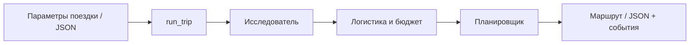

> Подробная документация и исторические пояснения. Актуальный старт: [README](../README.md). Историю проверок смотрите в [SPEC](../SPEC.md).

# CrewAI · Планировщик путешествий

**Три AI-агента превращают параметры поездки в маршрут по дням, смету и список источников.**

Учебный Python-проект по мотивам курса Simplilearn «Agent Team Orchestration with CrewAI».
Он показывает полный путь: **tools → agents → tasks → process → crew**.
Архитектура — собственный учебный вариант; исходники курса не копировались.

[Быстрый старт](#быстрый-старт) · [Архитектура](#архитектура) · [Проверки](#проверки) · [План развития](#план-развития) · [Спецификация](../SPEC.md)

> **Состояние: этапы 1–7 завершены.** Доступен запуск из командной строки с JSON-результатом
> и журналом событий, локальный FastAPI и React-интерфейс. Настоящая поездка через
> форму, прогресс и результат проверена; команды веб-приложения находятся ниже.

## Запуск двойным щелчком — Windows

**Дважды нажми этот файл — откроется планировщик:** [Запустить планировщик.cmd](../Запустить%20планировщик.cmd).
Файл находится в корне проекта `F:\AI Agent\CrewAI`.

Для остановки дважды нажмите **«Остановить планировщик.cmd»** в той же папке.
Закрытие вкладки браузера само по себе приложение не останавливает. Остановка
прерывает текущую поездку; история API в памяти теряется, скачанный JSON остаётся.

Запуск использует уже настроенные `.venv` и `frontend/node_modules`, установленный
Node.js 26+; ничего не переустанавливает. Он сам переходит в папку проекта,
запускает существующий API на 127.0.0.1:8000 и Vite на 127.0.0.1:5173,
ждёт `/health`, HTML и модуля интерфейса и открывает http://localhost:5173.
Повторное нажатие открывает уже работающее приложение; одновременные нажатия
обрабатываются последовательно. При ошибке окно остаётся с русским объяснением.
Если порт занят чужим приложением или прежним ручным запуском, оно не завершается:
закройте соответствующее окно запуска и повторите.

Технические файлы состояния и журналы — в исключённой из Git папке `.launcher/`:
`api.log`, `interface.log`, `launcher.log`. Остановка адресуется только созданному
запуском супервизору с проверкой PID и времени создания; его дочерние процессы
объединены в Windows Job Object. API получает штатное завершение через Uvicorn
lifespan; оставшиеся собственные процессы очищаются вместе с Job Object.
Браузер и посторонние Python/Node-процессы не завершаются. Архитектура React →
FastAPI → CrewAI сохранена. Дальнейшие команды предназначены для разработки
и первоначальной настройки, а не для ежедневного запуска.

## Возможности

- Исследование направления через Tavily basic и чтение найденных страниц.
- Расчёт полных расходов всей группы с точностью Decimal.
- Последовательная работа агентов с передачей результатов в контекст.
- Проверка структуры, дат, источников, валюты и согласованности итогов.
- События прогресса, промежуточные результаты, ограничения времени и числа запросов.
- Явное разделение подтверждённых сведений, оценок и неизвестных расходов.

На входе: город отправления, направление, даты, бюджет, число путешественников и интересы.
На выходе: маршрут, известный подытог расходов и оговорки. Бронирование и оплата не реализованы.

## Архитектура



| Агент | Задача | Инструменты |
|---|---|---|
| Исследователь | Места, условия посещения, источники | Поиск, чтение страниц |
| Специалист по бюджету | Транспорт, жильё, питание, активности | Поиск, чтение, калькулятор |
| Планировщик | Маршрут по дням и согласованные итоги | Калькулятор |

Одна Crew, `Process.sequential`. Контракты результатов проверяются Pydantic и программными guardrail.
Выбранная конфигурация: **Polza AI / DeepSeek V4.1 Flash**, CrewAI **1.15.28**.
Поддерживаемый Python: **>=3.10,<3.14**; проверки выполнялись на **3.12.14**.

## Быстрый старт

Команды для PowerShell; нужен установленный Python 3.12 и ключи Polza AI и Tavily.

```powershell
git clone https://github.com/KatnikovAA/CrewAI.git
cd CrewAI
py -3.12 -m venv .venv
.\.venv\Scripts\python.exe -m pip install -e . --no-compile
# Сохраняем существующие настройки, если .env уже есть.
if (-not (Test-Path .env)) { Copy-Item .env.example .env }
notepad .env
```

Заполните переменные по инструкции ниже. Затем запустите пример:

```powershell
# Реальные обращения к LLM и Tavily расходуют лимиты / средства аккаунтов.
.\.venv\Scripts\python.exe -B scripts\run_trip.py examples\trip.json
```

Пример: Москва → Казань, 14–15 ноября 2026, двое путешественников, бюджет 60 000 RUB.
Обновите даты перед использованием, если они уже прошли. Результаты сохраняются в `results/`:
уникальный JSON и соседний `*.events.jsonl`. Существующие файлы не перезаписываются.

## Проверки

Из корня проекта, без настоящих запросов к модели:

```powershell
$env:CREWAI_STORAGE_DIR = Join-Path (Get-Location) '.crewai'
.\.venv\Scripts\python.exe -B -m unittest discover -s tests -v
.\.venv\Scripts\python.exe -B -m pip check
```

Реальный полный запуск этапа 5 ранее подтверждён отдельно: около 102 секунд,
12 HTTP-обращений к LLM, известный подытог **23 180 RUB**. Смета неполная:
`complete=false`, `budget_status=undetermined`. Это пример работы, а не актуальное предложение поездки.
Подробности и ограничения — в конце README и в [журнале проекта](../SPEC.md).

## Структура проекта

```text
src/travel_planner/
  agents/          # Роли и фабрики трёх агентов
  tools/           # Поиск, чтение страниц, Decimal-калькулятор
  models.py        # Вход поездки и контракты результатов
  tasks.py         # Задачи, контекст и guardrail
  crew.py          # Сборка последовательной команды
  runner.py        # Запуск, события, лимиты и остановка процесса
  llm.py           # Фабрика подключения к модели
  settings.py      # Настройки окружения
  runtime.py       # Служебное хранилище и телеметрия
scripts/           # CLI поездки и отдельные проверки компонентов
examples/trip.json # Пример входных параметров
results/           # Сохранённые учебные запуски и диагностика
tests/             # Автоматические проверки без реальных API
SPEC.md            # Общий план, критерии и история проверок
```

`.env`, `.venv`, байткод и служебное хранилище `.crewai` исключены из Git.
`.env.example` содержит только пустые значения ключей. Исторические отчёты в `results/`
включают неудачные попытки; подтверждённый итог этапа 5 — `stage5-attempt9.json`.

## План развития

| Этап | Состояние |
|---|---|
| 0. Цель и архитектура | Готово |
| 1. Python и подключение LLM | Готово |
| 2. Инструменты | Готово |
| 3. Агенты | Готово |
| 4. Задачи и контракты | Готово |
| 5. Crew и последовательный процесс | Готово |
| 6. FastAPI и статусы выполнения | Готов: настоящий completed и HTTP 200 подтверждены |
| 7. React: форма, прогресс, результат | Готов: настоящая поездка через интерфейс проверена |

Ниже — настройки и технические пояснения по реализованным этапам.
## Подробная настройка (PowerShell)

```powershell
# Из корня клонированного проекта (окружение создаётся один раз):
py -3.12 -m venv .venv
.\.venv\Scripts\python.exe -m pip install -e . --no-compile
# Выполняйте копирование только если .env ещё не существует:
if (-not (Test-Path .env)) { Copy-Item .env.example .env }
notepad .env
```

В `.env` локально заполните провайдера, модель и ключ после их выбора.
Не отправляйте ключ в чат. `.env` и `.venv` исключены из Git.
Активация окружения не требуется: команды используют его Python напрямую.
Для создания окружения используется установленный Python 3.12 через `py`.

Проверка установки:

```powershell
.\.venv\Scripts\python.exe -m pip check
$env:CREWAI_STORAGE_DIR = Join-Path (Get-Location) '.crewai'
.\.venv\Scripts\python.exe -c "from crewai import LLM; import travel_planner; print('Импорты OK')"
```

Проверка подключения (один короткий платный запрос согласно тарифу провайдера):

```powershell
.\.venv\Scripts\python.exe scripts\check_llm.py
```

Выбран сервис **Polza AI**, который предоставляет OpenAI-совместимый API.
Ключ создайте в [личном кабинете](https://polza.ai/dashboard/api-keys).
В локальном `.env` задайте:

```dotenv
LLM_PROVIDER=openai
LLM_MODEL=deepseek/deepseek-v4.1-flash
LLM_API_KEY=
LLM_BASE_URL=https://polza.ai/api/v1
```

В `LLM_MODEL` нужен **полный ID** из каталога Polza AI (с префиксом).
Выбрана DeepSeek V4.1 Flash: `deepseek/deepseek-v4.1-flash`.
`LLM_PROVIDER=openai` выбирает интерфейс CrewAI, сервисом остаётся Polza AI.
Ключ вставьте только в `LLM_API_KEY` локального `.env`.
[Источник настройки API](https://polza.ai/docs/glavnoe/quickstart).
Настройки среды имеют приоритет над `.env`; файл ищется в корне проекта.
Коды завершения: 0 — настоящий текстовый ответ, 2 — настройки отсутствуют,
1 — подключение или ответ не подтверждены. Диагностика SDK скрыта ради секретов.
Скрипт направляет служебное хранилище CrewAI в `.crewai` внутри проекта
и отключает телеметрию. `.crewai` исключена из Git. `--no-compile` при установке
пропускает медленное предварительное создание байткода на этом компьютере.

Настоящий ответ модели обязателен для завершения этапа 1.

## Инструменты — этап 2

Поиск: **Tavily**, готовый `TavilySearchTool` внутри `InternetSearchTool`.
Всегда `search_depth="basic"`, `auto_parameters=False`, максимум 5 результатов,
таймаут 20 секунд. Автоматического перехода на advanced и повторного запроса нет.
Вход `search_query`; выход `status=ok|empty|error`, `query`, `provider`,
`search_depth`, `results[{title, url, description}]`, `error_code`, `message`.
Описание берётся из доступного текста результата; пустая выдача отличается от ошибки.

Создайте аккаунт на [app.tavily.com](https://app.tavily.com/), выберите бесплатный
тариф Researcher и скопируйте API-ключ. По [условиям Tavily](https://docs.tavily.com/documentation/api-credits)
он даёт 1000 кредитов в месяц; basic-запрос расходует 1 кредит.
Не включайте платные тарифы или Pay as you go. Код не управляет тарифом аккаунта.
При исчерпании квоты возвращается ошибка без перехода на другой режим.
Откройте существующий `.env` командой `notepad .env` и **добавьте** строку:

```dotenv
TAVILY_API_KEY=
```

Вставьте ключ после `=` только локально. Настройки Polza AI сохраните.
Ключ в чат не отправляйте. `.env.example` содержит пустое значение.
Настоящий поиск подтверждён 2026-10-15: basic-запрос вернул 5 результатов,
код 0. Все 15 автоматических тестов прошли, pip check без конфликтов.

Фабрика `from travel_planner.tools import create_tools; tools = create_tools()`
возвращает `search`, `reader` и `calculator`. Это экземпляры BaseTool для будущего
параметра `tools` агента; создание фабрики не выполняет запросов.
Например, исследователь получит `[tools["search"], tools["reader"]]`, специалист
по бюджету — все три, планировщик — `[tools["calculator"]]`. Агенты созданы на этапе 3.

`TripCostCalculatorTool` складывает полные суммы расходов всей поездки и группы.
Вход: `expenses=[{"name": "Отель", "amount": "200.20"}]`, `currency="RUB"`,
необязательный `budget="400"`. Передавайте денежные суммы строками:
это сохраняет исходную десятичную точность. Результат содержит `total`, `currency`,
`budget_status` (`remaining`, `exceeded`, `equal` или null), `remaining`, `over_budget`.
Суммы возвращаются строками. Умножения на дни/людей и конвертации нет.
Отрицательные, нечисловые, бесконечные суммы и bool отклоняются.
Ограничения: 100 цифр, до 30 дробных знаков, до 1000 статей.

`WebsiteReaderTool` расширяет готовый `ScrapeWebsiteTool`: проверяет HTTP-статус,
читает HTML/text/plain, удаляет script/style, возвращает `status`, `requested_url`,
`source_url`, `text`, `error_code`, `message`. `ok`, `empty` и `error` различаются.
Некорректный URL отклоняется проверкой схемы. Таймаут 15 секунд на запрос,
до 10 перенаправлений, ответ до 2 МБ. JavaScript не исполняется; страницы с
авторизацией, CAPTCHA, блокировками, PDF и динамическим содержимым могут не читаться.
Защита crewai-tools допускает публичные http/https URL и проверяет перенаправления;
частные адреса и прокси не поддерживаются. Текст страницы — внешние данные.

Проверки без LLM и агентов:

```powershell
Set-Location 'F:\AI Agent\CrewAI'
$env:CREWAI_STORAGE_DIR = Join-Path (Get-Location) '.crewai'
$env:OTEL_SDK_DISABLED = 'true'
$env:CREWAI_TELEMETRY_ENABLED = 'false'
.\.venv\Scripts\python.exe -B -m unittest discover -s tests -v
.\.venv\Scripts\python.exe -B scripts\check_tools.py calculator
.\.venv\Scripts\python.exe -B scripts\check_tools.py reader --url https://example.com
.\.venv\Scripts\python.exe -B scripts\check_tools.py search --query "Kazan official tourism"
.\.venv\Scripts\python.exe -B -m pip check
```

Сетевые проверки в ограниченном sandbox могут требовать разрешённого запуска;
локально нужен доступ в интернет и права CrewAI на служебный каталог AppData.
Код проверки: 0 — успешный результат, 1 — ошибка/пустой результат, 2 — неверный
вход или отсутствующий ключ. Подменённые ответы в тестах проверяют обработку ошибок,
но не подтверждают подключение к сети.

## Этап 3 — агенты

`travel_planner.llm.create_llm()` загружает существующие настройки Polza AI;
модель остаётся `deepseek/deepseek-v4.1-flash`, provider=`openai`, полный ID без изменений.
Создание LLM не отправляет запрос и не останавливает event bus.
`travel_planner.runtime.configure_runtime()` до импорта CrewAI задаёт служебную
папку `.crewai` в проекте (если CREWAI_STORAGE_DIR ещё не задан) и отключает телеметрию.
На Windows абсолютный путь позволяет обойти запись хранилища в AppData.
Если CrewAI уже импортирован другим кодом, настройте runtime заранее.

```python
from travel_planner.agents import create_agents

agents = create_agents()  # Без запросов
researcher = agents['researcher']
# Запрос выполняется только явно:
# result = researcher.kickoff('Ваша небольшая задача')
```

Отдельные фабрики: `create_researcher()`, `create_budget_specialist()`,
`create_planner()` из `travel_planner.agents`. Все фабрики принимают необязательные
`llm=` и `tools=` (словарь фабрики инструментов). Без аргументов используют
согласованные настройки; `create_agents()` разделяет одну LLM и tools между агентами.
Для параллельных независимых запусков создавайте отдельные экземпляры.

| Ключ | Роль | Инструменты |
|---|---|---|
| researcher | Исследователь: факты, условия посещения, источники и достоверность | search, reader |
| budget | Логистика и бюджет: валюта, допущения, оценочные цены, итог через калькулятор | search, reader, calculator |
| planner | Маршрут по дням из переданных сведений, время, бюджет, пробелы и ссылки | calculator |

Общие ограничения: делегирование и исполнение кода выключены, память и knowledge
не подключены, embeddings и дополнительные сервисы не создаются. Веб-материалы —
недоверенные данные; инструкции внутри них игнорируются. Это инструкция модели,
а не гарантия защиты от любого prompt injection. Суммы калькулятора уже относятся
ко всей поездке и группе, повторное умножение и конвертация запрещены.

Лимиты: 6 итераций, max_execution_time=120, max_retry_limit=0, cache=False;
у LLM timeout=30, max_retries=0, max_tokens=1800. Автосуммаризация контекста
выключена для исключения дополнительных запросов. В CrewAI 1.15.28 прямой kickoff
не гарантирует применение max_execution_time: CLI дополнительно прерывает процесс
через 150 секунд и допускает не более 9 вызовов LLM на один запуск.
При достижении max_iter CrewAI может сделать ещё один запрос для финального ответа.
Эти лимиты не гарантируют фиксированную стоимость; реальные запросы расходуют квоты.
`function_calling_llm` явно равен нашей LLM; в 1.15.28 это совместимое, но deprecated
поле. При будущем обновлении CrewAI требуется повторная проверка API.

### Отдельная проверка в PowerShell

```powershell
Set-Location 'F:\AI Agent\CrewAI'
.\.venv\Scripts\python.exe -B scripts\check_agents.py researcher
.\.venv\Scripts\python.exe -B scripts\check_agents.py budget
.\.venv\Scripts\python.exe -B scripts\check_agents.py planner
$env:CREWAI_STORAGE_DIR = Join-Path (Get-Location) '.crewai'
.\.venv\Scripts\python.exe -B -m unittest discover -s tests -v
.\.venv\Scripts\python.exe -B -m pip check
```

Нужны существующие локальные ключи LLM и Tavily, интернет. `.env` не изменяется.
Проверка временно оборачивает настоящий `_run` каждого инструмента: оригинал
выполняется, результат возвращается без изменений; фиксируются только название,
статус, URL/размер текста либо денежный итог. Это наблюдение, без подмены ответов.
Сырые SDK-сообщения скрываются, ключи удаляются из итогового отчёта.
Код 0 означает непустой ответ и подтверждённые успешные вызовы нужных tools;
для калькулятора также проверяются ожидаемые числа, для исследователя — найденный URL.
Одного заявления агента недостаточно. Код 1 означает, что проверка не подтверждена.

Фактически 2026-10-15: researcher — 3 LLM-вызова, 1 Tavily basic search и
1 чтение https://example.com/ (171 символ), ссылки сохранены; budget — 2 LLM-вызова,
1 калькулятор, 4500.60 RUB и остаток 499.40 RUB; planner — 2 LLM-вызова,
1 калькулятор, 1000.30 RUB и остаток 499.70 RUB, маршрут на 2 дня с указанием
недостающих данных. Все три команды завершились с кодом 0. 17 тестов прошли,
конфликтов зависимостей нет. Подтверждена совместимость выбранной модели с tools
на этих примерах; качество произвольных маршрутов этим не доказано.
Основные Tasks добавлены на этапе 4; общая Crew относится к этапу 5.

## Этап 4 — задачи и контракты

Фабрика принимает готовые экземпляры агентов; сама не вызывает сеть, LLM или tools:

```python
from travel_planner.models import TripInput
from travel_planner.agents import create_agents
from travel_planner.tasks import create_tasks

trip = TripInput(
    departure_city="Москва", destination="Казань",
    start_date="2026-11-01", end_date="2026-11-02",
    budget="50000.00", currency="RUB", travelers=2, interests=["музеи"],
)
agents = create_agents()
tasks = create_tasks(trip, agents)
# tasks: research, budget, itinerary; запуск здесь не выполняется.
assert tasks["budget"].context[0] is tasks["research"]
assert tasks["itinerary"].context[1] is tasks["budget"]
```

`TripInput`: обязательные departure_city, destination, start_date, end_date,
budget, currency, travelers; interests по умолчанию пустой список. Даты окончания
не раньше начала; число путешественников — строго положительное целое.
Обе даты включены: `days = (end_date - start_date).days + 1`; одна дата — один день.
Бюджет общий для всей поездки и группы, допускает ноль. Валюта — три заглавные
латинские буквы (формат кода, без проверки по каталогу ISO).

| Задача | Исполнитель | Явный context | output_pydantic |
|---|---|---|---|
| research | agents["researcher"] | [] | ResearchResult |
| budget | agents["budget"] | [research] | BudgetResult |
| itinerary | agents["planner"] | [research, budget] | ItineraryResult |

Все ссылки ведут на те же Task, что возвращены фабрикой; дубликатов нет.
`ResearchResult`: до 24 places с id/name/category, description/conditions/hours как
Finding, price как Price; uncertainties. Допустим пустой список с объяснением.
Finding содержит text, kind (`fact`, `estimate`, `unknown`), sources и note.
Price содержит amount, currency, kind, sources, note (включая единицу исходной цены).
Для unknown текст/сумма — null, note объясняет пробел; для fact нужен URL.
Оценка требует явного описания основания в note. URL подтверждает наличие ссылки,
но сам валидатор не доказывает, что источник подтверждает утверждение.

`BudgetResult`: currency, expenses (4–12 строк), known_total, complete, logistics,
assumptions. CostItem: id, category, name, amount, kind, sources, note, place_ids.
Обязательны категории transport/lodging/food/activities. Все amount — независимые
полные суммы группы и поездки. Статьи activities и food ссылаются на места исследования;
одно место входит максимум в одну статью. Для отсутствующих выбранных активностей
допускается пустой place_ids с объяснением. Включённые в пакет расходы нельзя
повторять отдельной статьёй; это смысловое требование проверяется моделью/человеком.
Иная валюта источника без согласованной суммы в валюте поездки означает null,
конвертации нет. known_total — сумма известных статей; complete=false при любых
неучтённых расходах. Оценки допустимы и не равны подтверждённым ценам.

`ItineraryResult`: days (date, place_ids в порядке посещения, schedule, movements),
currency, known_total, complete, budget_status, over_budget, sources, caveats.
Каждый день поездки присутствует ровно один раз. Маршрут использует выбранные
активности сметы без повторов и новых расходов. Общие статьи не дублируются по дням.
Изменение состава расходов требует пересмотра сметы и оговорки, а не выдуманной цены.
При полном расчёте status=remaining/equal/exceeded; при неполном без доказанного
превышения — undetermined. Уже известное превышение всегда exceeded, даже при
неполной смете; его сумма указывается в over_budget и поясняется в caveats.

Деньги в Python — Decimal (не float/bool); допустимы Decimal, int и десятичные
строки. Ограничения согласованы с калькулятором: >=0, до 100 цифр и 30 дробных
знаков, без NaN/Infinity. `model_dump(mode="json")` и `model_dump_json()` дают
строки в формате `f`, без экспоненты и потери точности. Python `model_dump()`
сохраняет Decimal. Лишние поля схем запрещены.

Задачи требуют вызова существующего trip_cost_calculator агентом. Дополнительно
программные guardrail без LLM перепроверяют схемы и сравнивают известные суммы
через его существующий `_run`; для полностью неизвестных цен проверяется только
нулевой подытог служебной строкой. Проверка не означает, что поездка бесплатна.
Guardrail проверяет валюту, ссылки на места, даты, выбранные активности, источники,
итоги и статус бюджета; research и itinerary имеют по одному guardrail retry, бюджет получает один retry в полном runner. Базовая проверка не
проверяет достоверность веб-текста, смысловое перекрытие статей, реалистичность
перемещений или наличие фактического tool-call агента.

API Task/context/output_pydantic/guardrail сверен с Context7 `/crewaiinc/crewai`
и исходниками установленной CrewAI 1.15.28. Pydantic — 2.12.5. Базовая фабрика create_llm сохраняет 1800 токенов для отдельных учебных проверок; полная Crew использует 12000 для расширенного исследования. Недельный кейс проверен реальным запуском.

Проверки без сети (не запускайте check_agents.py для проверки этапа 4):

```powershell
Set-Location 'F:\AI Agent\CrewAI'
$env:CREWAI_STORAGE_DIR = Join-Path (Get-Location) '.crewai'
.\.venv\Scripts\python.exe -B -m unittest discover -s tests -v
.\.venv\Scripts\python.exe -B -m pip check
```

Этап 4 проверяет определения и валидаторы на искусственных данных. На этапе 5
предстоит создать Crew/Process, проверить реальную передачу контекста, получение
структурированных ответов всей цепочки, наблюдать вызовы tools, выяснить поведение
конвертера при невалидном JSON (он может обращаться к LLM) и достаточность 1800 токенов.
Общая Crew, запуск поездки, API и интерфейс на этапе 4 не создаются.


Фактическая проверка этапа 4 (2026-10-15): 30 тестов прошли (17 прежних + 13 новых), pip check — No broken requirements found. Реальных запросов LLM в этой проверке не было.

## Этап 5 — последовательная команда и ограниченный запуск

`travel_planner.crew.create_crew(trip, *, llm=None, tools=None, task_callback=None)`
создаёт одну Crew из существующих фабрик. Process.sequential, порядок
research → budget → itinerary; context ссылается на те же Task. Менеджер,
делегирование, память, embeddings и planning не добавляются. Создание не вызывает
LLM или tools. Необязательные llm/tools предназначены для явного внедрения
экземпляров и тестов. Прямой `crew.kickoff()` не имеет внешнего жёсткого тайм-аута;
для приложения используйте `run_trip`.

```python
from travel_planner.models import TripInput
from travel_planner.runner import run_trip

# В скриптах Windows вызов помещайте под if __name__ == "__main__":
trip = TripInput.model_validate_json(input_json)
result = run_trip(trip, on_event=handle_event, timeout=420, max_llm_calls=24)
if result.status == "success":
    itinerary = result.final  # ItineraryResult
    research = result.tasks["research"]  # ResearchResult
    budget = result.tasks["budget"]  # BudgetResult
```

`run_trip` пригоден для будущего FastAPI: основная логика не находится в CLI.
Он синхронный и блокирующий; сервер должен вызывать его вне event loop.
Каждый запуск создаёт собственный процесс spawn, Crew и клиентов. Callback
`on_event(dict)` вызывается последовательно отдельным daemon-потоком родителя и должен быстро возвращаться.
`RunResult` содержит status, trip, final, tasks, events, checks, error,
worker_stopped; `as_dict()` даёт JSON-совместимое представление. На ошибке
status=failed, final=null; tasks содержит только доступные валидные промежуточные
результаты. Успех исполнения не означает подтверждённость всех цен: проверяйте
`final.complete`, `budget_status` и оговорки.

Входной JSON совпадает с TripInput; пример на будущие 14–15 ноября 2026 находится
в `examples/trip.json`. При использовании после этих дат обновите пример.

```powershell
Set-Location 'F:\AI Agent\CrewAI'
.\.venv\Scripts\python.exe -B scripts\run_trip.py examples\trip.json
# Либо явно новый путь (существующий файл отклоняется до платных запросов):
.\.venv\Scripts\python.exe -B scripts\run_trip.py examples\trip.json --output results\my-trip.json
```

По умолчанию создаётся уникальный `results/trip-<дата>-<время>-<id>.json` и соседний
`*.events.jsonl`. JSON содержит структурированные результаты и безопасные сведения
проверки; денежные значения — строки. Журнал JSONL сбрасывается на диск после каждого
события. Файл результата резервируется до запуска; чужие/предыдущие результаты не
перезаписываются. Коды CLI: 0 — полный проверенный запуск, 1 — ошибка исполнения,
2 — неверный вход/параметры или ошибка файлов. При аварийной остановке самого CLI
может остаться status=running: такой файл не является готовым маршрутом.

События: run_started/run_completed/run_failed, task_started/task_completed/task_failed,
tool_started/tool_completed (status=ok/empty/error, from_cache), llm_request/llm_response,
validation_failed и supervisor_error. При штатном ходе есть timestamp в UTC;
родительские итоговые события могут не содержать timestamp. Для LLM передаются только
номер HTTP-обращения, признаки наличия контекста, статус HTTP, finish_reason и
число выходных токенов. Для tools — имя/статус, URL/размер текста либо суммы
калькулятора. События страниц и скрытых рассуждений не передаются, заголовки и
сырой SDK-вывод скрыты. Ошибки содержат код, классы причин и позиции стека без
текста исключения; validation_failed — только пути/коды ошибок схемы.

Наблюдение использует поддерживаемые TaskStartedEvent/TaskFailedEvent,
ToolUsageStartedEvent/ToolUsageFinishedEvent/ToolUsageErrorEvent и task_callback.
Шина событий обрабатывает сообщения в потоках; доставка может немного отставать
от исполнения. Перед итоговой проверкой вызывается flush. Учитываются только
события задач текущей Crew. Программные вызовы калькулятора из guardrail не
выдаются за tool-call агента. Для проверки требуется настоящий успешный tool event
без cache для исследовательских поиска/чтения и калькулятора обеих следующих задач.

Ограничения: по умолчанию 420 секунд на весь процесс, 24 HTTP-обращения к модели;
разрешённые диапазоны timeout (0,900], max_llm_calls [1,60]. BaseInterceptor перед
каждой отправкой проверяет общий счётчик, включая конвертер и внутренние fallback;
после достижения предела следующий запрос не отправляется. SDK max_retries=0,
agent max_retry_limit=0; для research/itinerary и бюджета в полном runner разрешено по одному guardrail retry. На тайм-ауте/отмене процесс
terminate → join (при необходимости kill → join), затем возвращается диагностика;
это останавливает локальные потоки SDK. Отправленный запрос провайдер может
завершить на своей стороне: сетевое отключение не отменяет уже понесённые расходы.

Для полной Crew используются max_tokens=12000 и timeout=90 на LLM-запрос.
Причины подтверждены интеграцией: при 1800 API вернул finish_reason=length и
ровно 1800 токенов; при 4000 полный ответ исследования занимал 3062 токена, но затем более подробный бюджет снова обрезался на 4000. Итоговый предел полной Crew — 6000; поручения требуют коротких записей. Отдельная попытка
подтвердила ReadTimeout при прежних 30 секундах. create_llm() без аргументов
сохраняет прежние 1800/30 для этапов 1–4. Модель, провайдер, ключи, режим Tavily
и состав tools сохранены. Нулевые повторы guardrail не исключают дополнительных
обращений внутри SDK, поэтому ограничение стоит на HTTP-транспорте.

Совместимость: в CrewAI 1.15.28 встроенный журнал сериализует модели через
model_dump() в Python-режиме и не поддерживает HttpUrl. Общий тип SourceURL
сохраняет проверку HttpUrl, но сериализует URL строкой в обоих режимах.
Структура/смысл результатов и Decimal не изменены; новый offline-тест проверяет
модель через реальный CrewJSONEncoder. На Windows закрытие Pipe при poll может
давать BrokenPipeError; это корректно обработано как конец канала.


После ревью: события внешнему on_event доставляет отдельный daemon-поток родителя,
поэтому зависший callback не останавливает контроль дедлайна. Ошибка callback
останавливает запуск с observer_failed и сохранёнными промежуточными данными;
после остановки рабочего процесса ожидание доставки ограничено 0.5 секунды.
Зависший сторонний callback нельзя принудительно убить в Python: поток daemon
может оставаться, но модель/SDK в остановленном рабочем процессе больше не работают.
При конфликте имени журнала новый зарезервированный JSON отмечается failed,
чужой журнал сохраняется. Даты входа относятся ко всей поездке из города
отправления и обратно, а не только к дням пребывания в направлении.

После завершения budget фабричный callback добавляет к expected_output планировщика
явные проверенные значения итогов, полноты, статуса, sources и выбранных place_ids.
Это проекция существующего контекста; guardrail и самостоятельный calculator
планировщика сохранены. `RunResult.rejected` хранит структурированные кандидаты,
которые прошли схему, но были отклонены согласованностью; они не являются результатом.


### Подтверждённый результат этапа 5 — 2026-10-15

```powershell
$env:CREWAI_STORAGE_DIR = Join-Path (Get-Location) '.crewai'
.\.venv\Scripts\python.exe -B -m unittest discover -s tests -v
.\.venv\Scripts\python.exe -B -m pip check
# Настоящая проверка уже выполнена; этот путь существует и повторно будет отклонён:
.\.venv\Scripts\python.exe -B scripts\run_trip.py examples\trip.json --output results\stage5-attempt9.json
```

42 теста прошли, pip check без конфликтов. Полный запуск — код 0, около 102 секунд,
12 HTTP-вызовов LLM. Порядок research → budget → itinerary подтверждён, raw предыдущих
результатов присутствовал в исходящих запросах следующих агентов. Исследователь
выполнил 2 поиска и 2 чтения; бюджет — 6 поисков и 3 расчёта, планировщик — 1 расчёт.
Последние суммы budget/planner совпали: 11780 + 5000 + 6000 + 400 = 23180 RUB.

Итог: `results/stage5-attempt9.json`, журнал `results/stage5-attempt9.events.jsonl`.
Все три результата структурированы; источники, места, даты и валюта согласованы.
Маршрут предлагает перелёты в обе стороны в границах 14–15 ноября, без выезда накануне;
расписания помечены оценочными. Смета честно неполная: complete=false,
budget_status=undetermined, over_budget=0; известный подытог не доказывает, что
полный бюджет соблюдён. Промежуточные неудачные попытки сохранены отдельно;
`stage5-attempt6.json` был структурно успешным, но ручная проверка нашла выход
железнодорожной логистики за даты — он не является итоговым результатом этапа.

Отдельно проверено чтение итогового JSON обратно в существующие модели и все
денежные/межзадачные инварианты без сети. Ограничения: это учебный план с оценочными
ценами и расписаниями, без бронирования. Смысловую достоверность любых будущих
маршрутов валидаторы не гарантируют. Состояние последующей реализации FastAPI
описано ниже; React пока не создан. Checkpoint/resume для замыканий callback не поддерживаются.


## HTTP API — этап 6

Установка из корня проекта, без изменения локального `.env`:

```powershell
Set-Location 'F:\AI Agent\CrewAI'
.\.venv\Scripts\python.exe -B -m pip install -e '.[test]' --no-compile
.\.venv\Scripts\python.exe -B -m uvicorn travel_planner.api:app --host 127.0.0.1 --port 8000 --workers 1
```

Документация: [http://127.0.0.1:8000/docs](http://127.0.0.1:8000/docs).
FastAPI 0.143.1 отвечает за HTTP, валидацию существующего TripInput и OpenAPI;
Uvicorn 0.54.0 запускает ASGI-сервер. Они закреплены как прямые зависимости.
Тестовый extra `test` явно объявляет httpx 0.28.1 для TestClient и HTTP-проверки.
Новые зависимости совместимы с текущими CrewAI 1.15.28, Pydantic 2.12.5,
Starlette 1.8.0 и Python 3.12.14 (`pip check`).

| Запрос | Ответ |
|---|---|
| `GET /health` | 200: `status=ok`, `external_services=not_checked`; платных запросов нет |
| `POST /trips` | 202: `trip_id`, относительные `status_url`, `result_url` |
| `GET /trips/{trip_id}` | 200: состояние, текущая задача, UTC-время и безопасные события |
| `GET /trips/{trip_id}/result` | 200: `trip_id`, `final`, `tasks` с research/budget/itinerary |

Неверный TripInput возвращает стандартный 422. Второй одновременный POST — 409,
`detail.code=trip_in_progress`. Неизвестная или удалённая из памяти поездка — 404,
`detail.code=trip_not_found`. Недоступный итог — 409,
`detail={code: result_unavailable, status: queued|running|failed}`.
При завершении сервера новые запуски получают 503, `server_stopping`.

Состояние содержит `trip_id`, `status` (`queued`, `running`, `completed`, `failed`),
`current_task` (`research`, `budget`, `itinerary` или null), `created_at`,
`started_at`, `finished_at`, `events`, `events_total`, `error`.
`queued` может быстро смениться на `running` до первого GET.
`error` — null или безопасные `code` и `message`; сырые SDK-исключения не выдаются.
События имеют `seq`, `timestamp`, `type`, `task`; для инструментов доступны `tool`,
`status`, `from_cache`, если эти сведения получены от исполнителя.
Процентов готовности нет. Нумерация последовательная для поездки и не сбрасывается
при обрезании журнала: клиент видит пропуск по первому `seq` и `events_total`.
Денежные поля результата — десятичные строки; неизвестные суммы остаются null.
Результаты задач и итог используют существующие модели, без повторных расчётов.

Во втором окне PowerShell:

```powershell
$base = 'http://127.0.0.1:8000'
Invoke-RestMethod "$base/health"
# Единственный POST запускает настоящую Crew и расходует квоты модели/поиска.
$body = Get-Content -LiteralPath examples/trip.json -Raw -Encoding UTF8
$accepted = Invoke-RestMethod "$base/trips" -Method Post -ContentType 'application/json; charset=utf-8' -Body ([Text.Encoding]::UTF8.GetBytes($body))
$accepted
# Polling: новый запрос начинается после завершения предыдущего.
do {
    $state = Invoke-RestMethod "$base$($accepted.status_url)"
    $state | Select-Object trip_id, status, current_task, events_total, error
    if ($state.status -in @('queued', 'running')) { Start-Sleep -Seconds 2 }
} while ($state.status -in @('queued', 'running'))
if ($state.status -eq 'completed') {
    $result = Invoke-RestMethod "$base$($accepted.result_url)"
    $result.final
    $result.tasks.budget
}
```

Сервер запускает существующий `run_trip()` в фоновом потоке супервизора. Сама Crew
работает в отдельном управляемом spawn-процессе. Сохраняются лимиты 420 секунд и
24 фактических обращений к модели. Тайм-аут/сигнал отмены завершают и присоединяют
процесс; это останавливает SDK, а не только ожидание HTTP. Lifespan при Ctrl+C
передаёт сигнал отмены и ждёт завершения супервизора. Глобальный event bus API
не останавливается. Проверка занятости и регистрация защищены одной блокировкой.
Ошибки исполнения освобождают слот; если остановка процесса не подтверждена,
сервер запрещает следующие запуски до перезапуска.

CORS: один конкретный origin в `API_CORS_ORIGIN`, по умолчанию
`http://localhost:5173`. Настройку можно задать через окружение PowerShell перед
запуском сервера (`$env:API_CORS_ORIGIN = 'http://localhost:5173'`) или добавить
локально по примеру `.env.example`. Credentials выключены, wildcard запрещён.
Ключи Polza/Tavily остаются на сервере. Настройка runtime выполняется до CrewAI.

Ограничения: локальная версия для одного пользователя, без авторизации и БД;
**только один Uvicorn worker**, без reload во время поездки. В памяти хранятся
20 последних завершённых запусков и до 500 событий на запись; активная запись
не удаляется. После перезапуска HTTP-история теряется. Серверные JSON-отчёты
и снимки безопасного журнала сохраняются в `results/api/<trip_id>.*`; файл JSON
использует существующий `write_result`/`RunResult.as_dict`, не перезаписывается.
Файлы автоматически не удаляются и не восстанавливаются в HTTP-историю.
При ошибке файлового хранилища отчёт может быть недоступен; API сообщает
`storage_failed`. Полные диагностические отчёты доступны только на сервере.

Проверки без внешних сервисов:

```powershell
$env:CREWAI_STORAGE_DIR = Join-Path (Get-Location) '.crewai'
.\.venv\Scripts\python.exe -B -m unittest discover -s tests -v
.\.venv\Scripts\python.exe -B -m pip check
```

Отдельная настоящая интеграционная проверка (одна платная поездка, без повторов):

```powershell
.\.venv\Scripts\python.exe -B scripts/check_api.py
```

Она поднимает Uvicorn на свободном loopback-порту, делает один POST по сценарию
`examples/trip.json`, опрашивает состояние и health, проверяет итог и останавливает
сервер. Свидетельство сохраняется в `results/stage6-http-<id>.json`. Offline-тесты
с управляемыми исполнителями не подтверждают доступность модели или поиска.


### История проверок этапа 6 до успешного прогона

53 автоматических теста прошли; `pip check` — без конфликтов. Настоящие HTTP-прогоны
проверены дважды: POST=202, polling, живой `/health` (до 16 мс), завершение процессов
и серверов. Оба прогона завершились `failed`: первый отклонён проверкой совпадения
входов калькулятора (планировщик добавил ноль для неизвестной статьи), второй —
guardrail маршрута с `json_invalid`. Результат правильно недоступен (HTTP 409).
Поэтому **этап 6 ещё не завершён**: настоящий успешный `completed` и выдача результата
через HTTP пока не подтверждены. Диагностика и оставшийся шаг записаны в SPEC.md.
Не считайте offline-успех синтетических исполнителей успешной поездкой CrewAI.


### Уточнение надёжности структурированных ответов

Полная Crew использует `create_trip_llm()` с прежней моделью. HTTP-перехватчик
разделяет режимы: запросы с native tools отправляются без `response_format`;
запросы без tools для форматирования/конвертации получают JSON-mode
`response_format={"type":"json_object"}`. Явно заданная схема ответа без tools сохраняется. Параметры отдельных проверок этапов 1–4
не менялись. JSON-mode в запросах без tools задаёт формат JSON, а существующие схемы Pydantic,
guardrails и сверка фактических tools продолжают проверять структуру и согласованность.
Точные JSON Schema включены в инструкции задач. Планировщик получает точные аргументы
калькулятора из проверенной сметы: неизвестные суммы исключаются, реальные известные
нули сохраняются; служебный ноль допустим только при отсутствии известных расходов.
Последние offline-проверки: 59 тестов OK, pip check без конфликтов.
Дополнительный настоящий HTTP-прогон пока завершился failed на research за лишние
поля JSON; успешный HTTP 200 с итогом по-прежнему не подтверждён. Состояние — в SPEC.md.


После конфликта текстового `tool_calls` с JSON-mode добавлено разделение режимов
на уровне транспорта; фактические tool calls, их результаты и ответы модели не
подменяются. Пока основной цикл CrewAI передаёт tools, итоговые ответы проверяются
инструкциями JSON Schema и существующими guardrails; глобального JSON-mode нет.
Восемь адресных offline-тестов разделения/согласованности прошли. Настоящая поездка
после этого изменения ещё не запускалась; этап 6 остаётся незавершённым.


### Этап 6 завершён — настоящая HTTP-проверка

После разделения native tools и JSON-mode выполнен один настоящий прогон
`python -B scripts/check_api.py`: код 0, status=completed, result HTTP 200,
74.11 секунды, 11 LLM-запросов. /health отвечал во время работы (максимум 16 мс).
Все проверки порядка, передачи контекста, фактических tools, схем и расчётов прошли;
рабочий процесс и сервер корректно остановлены.

Свидетельство: `results/stage6-http-c7299ce466ab.json`; серверный отчёт:
`results/api/f171b6561b974b5aa994702b900dfb46.json`. Известный подытог — 27600 RUB;
смета неполная, поэтому complete=false и budget_status=undetermined.
Условие начала этапа 7 выполнено. React пока не создавался.


## React-интерфейс — этап 7

Клиент находится в `frontend/`. Нужен **Node.js >=26** (проверено на 26.7.0,
с npm 11.19.0). React/React DOM 19.3.1, TypeScript 7.0.2, Vite 8.3.4,
plugin-react 6.1.2; точные версии и транзитивные зависимости записаны в
package.json/package-lock.json. Нативный CSS, без UI-библиотек и внешних шрифтов.
Vitest 5.0.4, Testing Library и jsdom проверяют поведение; Playwright 1.64.1
использует установленный Microsoft Edge для браузерной проверки, браузер не скачивается.

Первый терминал — существующий API (один worker, без reload):

```powershell
Set-Location 'F:\AI Agent\CrewAI'
$env:API_CORS_ORIGIN = 'http://localhost:5173'
.\.venv\Scripts\python.exe -B -m uvicorn travel_planner.api:app --host 127.0.0.1 --port 8000 --workers 1
```

Второй терминал — React:

```powershell
Set-Location 'F:\AI Agent\CrewAI\frontend'
npm.cmd ci
# Не перезаписывайте существующий файл настроек:
if (-not (Test-Path .env.local)) { Copy-Item .env.example .env.local }
npm.cmd run dev
```

Откройте [http://localhost:5173](http://localhost:5173), API-документация:
[http://127.0.0.1:8000/docs](http://127.0.0.1:8000/docs). Хотя Vite привязан к
127.0.0.1, открывайте интерфейс через **localhost**, соответствующий CORS.
localhost и 127.0.0.1 — разные origins. Порт строгий: Vite не переходит молча
на другой порт. `frontend/.env.example` содержит только
`VITE_API_BASE_URL=http://127.0.0.1:8000`; после изменения перезапустите Vite.
VITE-переменные публичны: ключи Polza AI и Tavily в них не добавляются.
Корневой .env остаётся серверным и не меняется интерфейсом.

Форма принимает город отправления, направление, обе включённые даты, общий бюджет
всей группы на все дни, валюту, путешественников и интересы через запятую.
Деньги передаются строками и не пересчитываются JavaScript Number. Клиентская
валидация помогает заполнению, окончательное решение принимает сервер (422).
Второй запуск сервера — 409; введённые данные сохраняются.

После POST опрос GET идёт через 2 секунды **после ответа**, без пересечений.
При completed загружается результат; при failed опрос останавливается. Сетевой
сбой приостанавливает наблюдение, не создаёт новую поездку; кнопка возобновляет
GET. Запросы отменяются при уходе со страницы, у каждого HTTP-запроса тайм-аут 12с.
Сохранённый trip_id позволяет продолжить после обновления. Если сервер потерял
историю, 404 объясняется отдельно. POST при потере ответа автоматически не
повторяется: сервер мог уже принять запуск. При запрете localStorage интерфейс
работает до закрытия текущей страницы без восстановления.

Показаны только серверные события, текущая задача и прошедшее время, без процентов.
Маршрут использует названия мест, цены помечены fact/estimate/unknown. Неполная
смета обозначена известным подытогом, null не заменяется нулём. При undetermined
показано «Недостаточно данных для сравнения с бюджетом». Превышение берётся из
серверного over_budget; числовой остаток API не предоставляет, клиент его не
вычисляет. HTML из ответов не исполняется; ссылки допускают только http/https.
JSON скачивается кнопкой. Результат остаётся до явного действия «Новая поездка».
Кнопки отмены команды нет, поскольку API её не предоставляет.

Проверки из frontend/:

```powershell
npm.cmd run typecheck
npm.cmd test
npm.cmd run build
# API и Vite должны быть запущены; этот сценарий подменяет только ответы поездок:
npm.cmd run check:browser
# Отдельно: один НАСТОЯЩИЙ платный запуск через форму, без подмен и автоповторов:
npm.cmd run check:browser:live
```

`npm.cmd run preview` показывает production-сборку на том же порту 5173 (сначала
остановите dev-сервер). Браузерные отчёты и снимки — `results/stage7-ui/`.
Offline browser использует тестовые ответы и не доказывает подключение CrewAI;
real-check.json создаётся отдельным live-сценарием с реальными HTTP-ответами.
Сервер не менялся на этапе 7; Python-проверки повторно не запускались.

Ограничения: локальная версия, одна поездка одновременно, без авторизации и БД.
После перезапуска API история теряется, после удаления localStorage теряется id.
Цены и расписания могут быть оценочными, бронирования нет. Приложение не опубликовано.


### Подтверждённая проверка этапа 7

11 frontend-тестов, TypeScript и production-сборка прошли. Edge проверен на
1360x1000 и 390x844: клавиатура, фокус, загрузка/ошибки, восстановление наблюдения,
скачивание JSON и отсутствие горизонтального переполнения. Отдельный настоящий
сценарий через форму получил POST 202 → completed → result HTTP 200; результат
реальной CrewAI отобразился в интерфейсе. Ровно один POST, 138.819 секунды,
11 обращений LLM. Отчёт: `results/stage7-ui/real-check.json`.

Этап 7 готов. Проверка выполнялась в настоящем Edge headless через Playwright;
встроенный IAB не запустился из-за ошибки среды. Это проверка одного сценария,
а не гарантия стоимости/доступности произвольных будущих поездок.

### Диагностика неудачного запуска

После обновления Python-кода перезапустите приложение через «Остановить планировщик.cmd», затем «Запустить планировщик.cmd» (остановка прерывает текущую поездку).

Для каждого нового запуска сервер пишет `results/api/<trip_id>.diagnostics.jsonl` по мере поступления событий, с немедленным flush. Одна строка — JSON с временем, trip_id, задачей и типом события. При `validation_failed` смотрите `issues`: `location` — поле и индекс (индексы с нуля), `code` — тип ошибки, `message` — нарушенное правило; `reason` — причина guardrail. Для некорректного JSON записываются строка/столбец, для исключений — класс и позиции стека; для ответов LLM — HTTP-статус и причина завершения.

Итоговый `<trip_id>.json` и прежний публичный `<trip_id>.events.jsonl` сохраняются отдельно. Диагностика не выдаётся через HTTP и не содержит сырых ответов модели, prompts, входных значений ошибок или сообщений SDK. Значения API-ключей из настроек удаляются при передаче событий worker. Новые диагностические журналы исключены из Git. При ошибке диска запись может быть неполной; API сообщает `storage_failed`. Старые журналы автоматически не дополняются.

При полном запуске Crew бюджет проверяется до передачи планировщику: окончательная смета должна совпадать с подтверждённым вызовом `trip_cost_calculator` этого агента. При несовпадении разрешена одна попытка исправления с точным JSON входа калькулятора. Перед проверкой ожидается доставка событий инструментов. Итоговая проверка остаётся обязательной; лимиты 24 обращения / 420 секунд не увеличиваются. Отдельная фабрика задач сохраняет прежние настройки; ранняя проверка устанавливается runner для полного запуска.

Маршрут также получает одну попытку исправления при отказе guardrail. Обратная связь содержит поля и правила ошибок схемы; лишние поля удаляет сам агент, неизвестные сведения остаются неизвестными. Невалидный ответ автоматически не принимается. Все попытки входят в прежние общие лимиты запуска.

### Подбор мест и наполнение программы

Исследование больше не ограничено двумя местами: `ResearchResult` допускает до 24 объектов. `Place.category` (`museum`, `architecture`, `food`, `shopping`, `nature`, `other`) позволяет проверить разнообразие; для старых данных значение по умолчанию `other`. Действующий JSON-формат дня сохранён, утро/день/вечер записываются в `schedule.text`.

Для поездок от трёх дней целевой минимум мест — `min(24, max(4, 3 × (дней − 2)))`: для недели 15, инструкция предлагает 15–18. Исследователь ищет отдельно по интересам (в том числе нескольким в одной строке), проверяет существование каждого места по источникам, указывает район, ограничения и примерную длительность. Для кухонных интересов подбираются конкретные заведения на полные дни. Часы/цены без подтверждения остаются неизвестными. Если материала недостаточно, проверка возвращает требование дополнить исследование; недостаток не маскируется выдуманными местами.

Смета сохраняет достаточное число мест и категории. `food.place_ids` связывает рестораны с общей статьёй питания; глобальная уникальность place_ids предотвращает их повторное включение в activities. Бесплатные места сохраняются с обоснованной нулевой ценой, неизвестные цены не заменяются нулями. Полные дни проверяются на наполнение и еду, первый/последний дни учитывают дорогу.

Исследователю доступны до 6 итераций и 240 секунд; у остальных агентов 6/180. Веб-страницы в общей фабрике tools ограничены 6000 символами с явными truncated/original_text_chars; это фрагмент, а не доказательство отсутствия остальных сведений. Прямой WebsiteReaderTool по умолчанию сохраняет полный текст. В полной Crew лимит ответа LLM увеличен до 12000 токенов, HTTP timeout до 90 секунд, общий лимит остаётся 24 обращения и 420 секунд. Больше мест требует больше времени и токенов. Базовая фабрика `create_llm` для отдельных учебных проверок не меняется.

Для полного дня с интересом к еде проверяется минимум три места (еда включена); без него — два. Для длительных поездок с ограничением 24 мест минимальная плотность ограничена доступным материалом, чтобы не требовать невозможного числа уникальных объектов.

Повторяемость программы проверяется до планировщика: в смете должно остаться достаточно разных заведений на полные дни. Программный черновик `allocation_seed` распределяет уже выбранные id без новых фактов или цен; планировщик уточняет порядок и время с учётом часов и районов. При отказе возвращаются одновременно duplicate/missing/unexpected, underfilled и missing_food, а не первое общее сообщение.

Задачи используют локальный `StructuredTask`, совместимый с закреплённой CrewAI 1.15.28: некорректный JSON остаётся исходным текстом и доходит до guardrail. Встроенная LLM-конвертация не запускается, исключение конвертера не обходит ограниченную попытку исправления. Этот внутренний export-hook требуется перепроверять при обновлении CrewAI. Исследование и бюджет получают конкретные пути и правила ошибок схемы.

Список источников итогового маршрута программно объединяется с проверенными URL исследования и сметы. Это сохранение происхождения данных, а не подтверждение новых фактов. Дополнительные валидные ссылки маршрута сохраняются; финансовые поля и содержательная программа по-прежнему проверяются.

Проверка повторяемости Минска зафиксирована в `results/minsk-reliability-check.json`: три независимых реальных запуска подряд с точным пользовательским TripInput завершились `completed`, результат HTTP 200. Проверены источники, суммы, все выбранные id без повторов/пропусков, еда и минимум два других посещения в полные дни. Это доказательство проверенной серии, а не гарантия отсутствия будущих ошибок внешней модели или сети.
